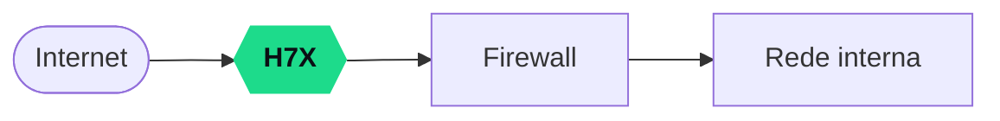

  

  
  
  
  

## Sobre mim

Cuido de redes, servidores, CFTV, controle de acesso e portaria inteligente como **Analista de Redes e Comunicação de Dados** desde Agosto de 2021. Antes da infraestrutura, foram cerca de 10 deles como designer e web designer em gráfica e editora. Daí vem o que eu busco: tecnologia que protege **e** que qualquer pessoa consegue usar.

- **Construindo** o **H7X**, uma camada de defesa de rede acessível para empresas sem analista de segurança
- **Sócio** do **[Calenia](https://calenia.com.br/)**, sistema de gestão para salões de beleza
- **Estudando** o último semestre de **Tecnólogo em Segurança da Informação** (Universidade Positivo) e *Redes de Computadores* (Tanenbaum), rumo a uma certificação de redes
- **Antes disso**, cursei **Direito** até o 8º período e fui mediador/conciliador extrajudicial no projeto Conciliere (Faculdade Positivo + PROCON Londrina)

## Em destaque: H7X Cyber Defense

Defesa ativa posicionada **antes do firewall**: mais uma camada de proteção entre a internet e a rede.

O H7X reúne **mais de 130 ferramentas** e protocolos de segurança já consagrados, empacotados para rodar em **Docker** ou em **hardware de baixo custo**, fazendo o papel de um analista de segurança para quem não tem um. A versão **Community** foi pensada para ser aberta à comunidade.

- **Origem:** nasceu na faculdade como um sentinela de rede IoT com ESP32 e display; virou containers depois da experiência configurando o UmbrelOS
- **Na prática:** testado em ambiente corporativo real e usado em um projeto ODS com tema de economia sustentável
- **Próxima fase:** versão para empresas de pequeno a grande porte, com preço fixo
- **Repositórios:** H7X Cyber Defense Community (Python, licença MIT), H7X Cloud (Python) e a landing page do projeto, ainda privados

<!-- Quando publicar os repositórios do H7X, troque os nomes acima pelos links -->

## Outros projetos

<table>
  <tr>
    <td width="50%" valign="top">
      <h3><a href="https://calenia.com.br/">Calenia</a></h3>
      
      
Gestão para salões de beleza: agenda da equipe com lista de espera, histórico de clientes, <b>confirmações e lembretes automáticos por WhatsApp</b>, financeiro, relatórios e estoque. Roda no navegador, no computador ou no celular.

      
Sou sócio e fiz o site. Também criei logotipo, marca e site da <a href="https://brachah.com.br/">Brachah</a>, clínica de podologia e estética em Londrina que usa o sistema.

    </td>
    <td width="50%" valign="top">
      <h3><a href="https://github.com/UkS4les/MTG-Meta">MTG Meta</a></h3>
      
      
      
      
      
Open source para Magic: The Gathering que mostra <b>o meta por formato</b> (Standard, Pioneer, Modern e Pauper, em janelas de 7, 14 e 30 dias) e <b>quais decks você já consegue montar</b>, cruzando sua coleção, de papel ou do Arena, com os arquétipos dos torneios do Magic Online.

      
Histórico de partidas e taxa de vitória pelo log do Arena. Next.js + Postgres embutido (PGlite), sobe com <code>docker compose up</code>; 102 testes e CI.

    </td>
  </tr>
  <tr>
    <td width="50%" valign="top">
      <h3>Forja</h3>
      
      
      
      
      
Jogo social para conectar profissionais de TI, web e design: uma <b>cidadela medieval cyberpunk</b> em visual isométrico, onde cada pessoa monta a sua loja e troca serviços, ajuda e networking. Desafios e eventos periódicos destacam quem se esforça.

    </td>
    <td width="50%" valign="top">
      <h3>TuxGG</h3>
      
      
      
Comunidade gamer focada em <b>Linux, jogos, programação e tecnologia</b>, conectando jogadores e desenvolvedores num ambiente acolhedor e colaborativo.

    </td>
  </tr>
  <tr>
    <td width="50%" valign="top">
      <h3><a href="https://github.com/UkS4les/XIso-Debian-Extrator-de-iso-xbox">XIso Extrator</a></h3>
      
      
      
Extrator de imagens XDVDFS (Xbox original e Xbox 360) para Linux, alternativa ao ExtractXISO do Windows. Detecta o layout da imagem, reconstrói a árvore de diretórios e tem interface gráfica (Tkinter) e linha de comando. Só Python, sem dependências externas.

    </td>
    <td width="50%" valign="top">
      <h3>Certificações e cursos</h3>
       
       
      
      
Cursos de <b>Hacker Ético com Kali Linux</b> e <b>Perícia Forense Computacional</b> (40 h).

      <!-- Se tiver o link do Credly ou da página de validação, envolva cada selo com <a href="LINK">...</a> -->
    </td>
  </tr>
</table>

## Ferramentas

<table>
  <tr>
    <td><b>Infra e segurança</b></td>
    <td>
      
      
      
      
      
      
      
      
    </td>
  </tr>
  <tr>
    <td><b>Desenvolvimento</b></td>
    <td>
      
      
      
      
      
      
      
    </td>
  </tr>
  <tr>
    <td><b>Hardware e IoT</b></td>
    <td>
      
      
      
      
    </td>
  </tr>
  <tr>
    <td><b>Design</b></td>
    <td>
      
      
      
      
      
    </td>
  </tr>
</table>
